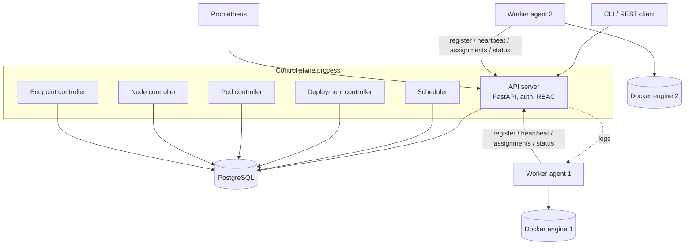
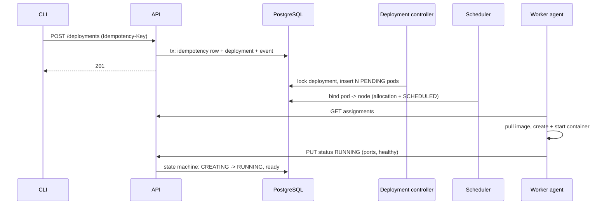
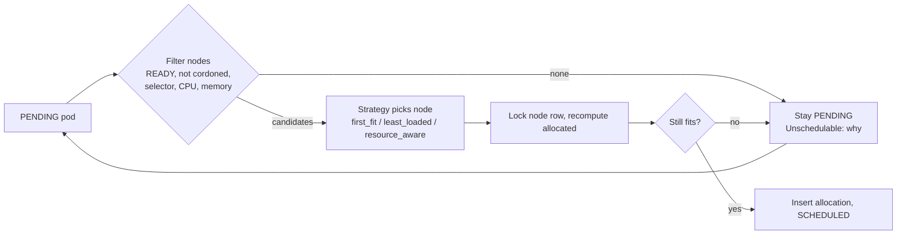
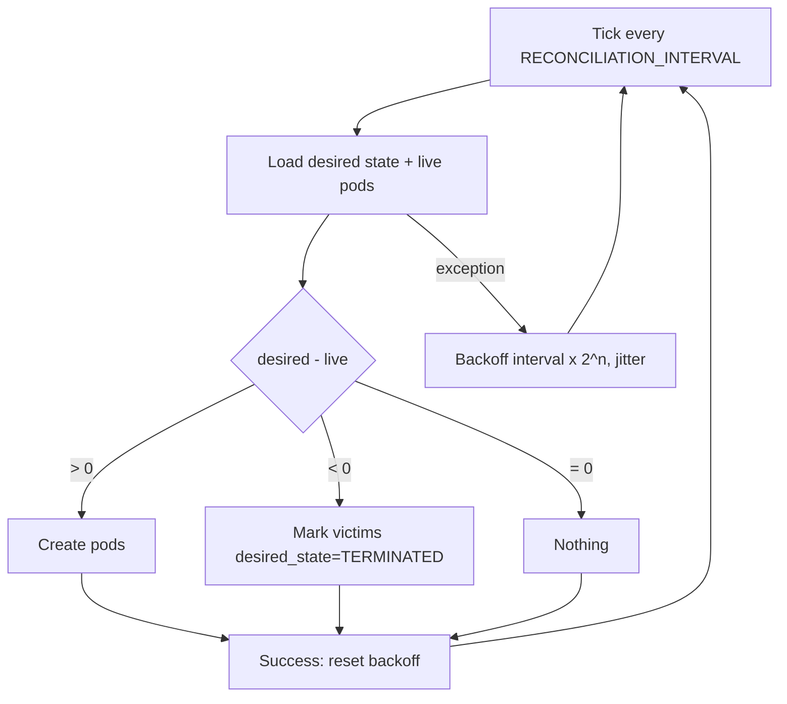
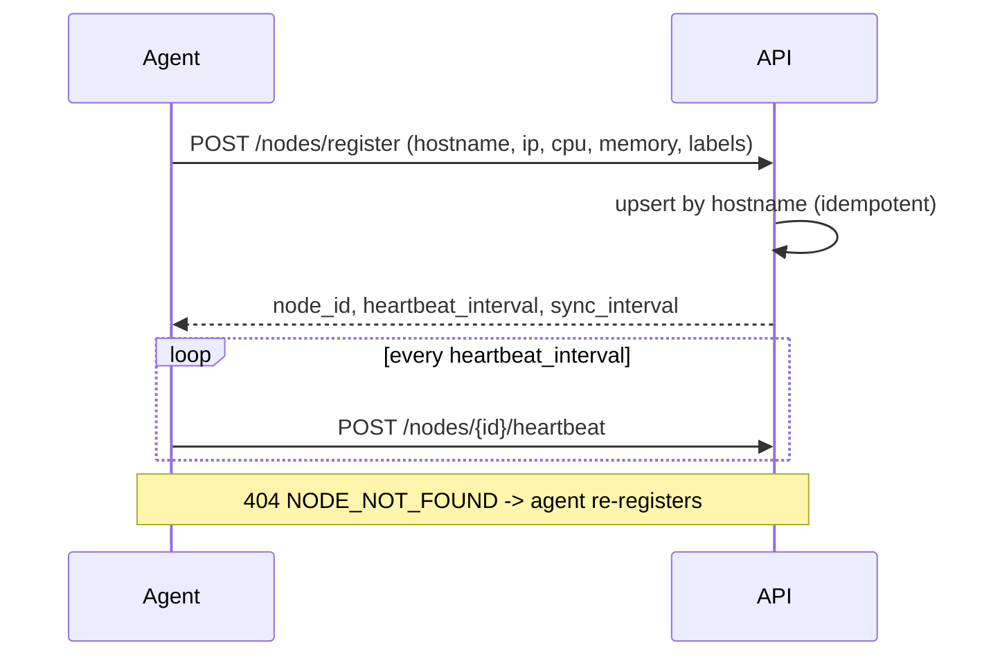
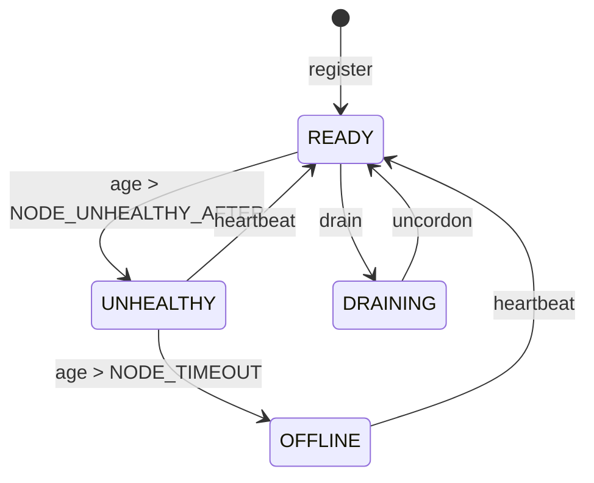
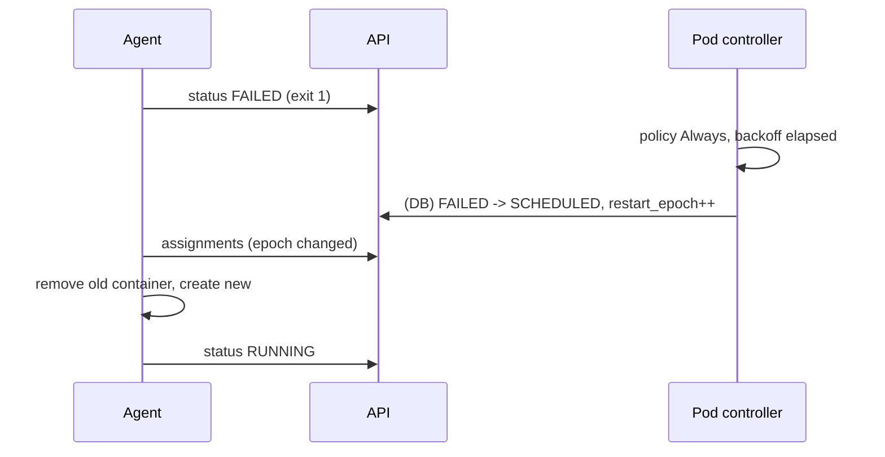
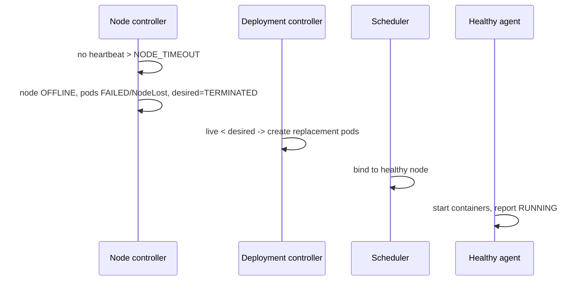
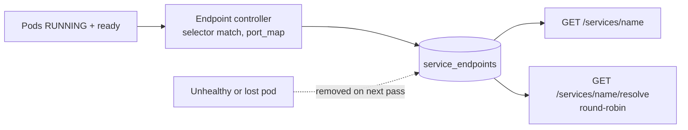
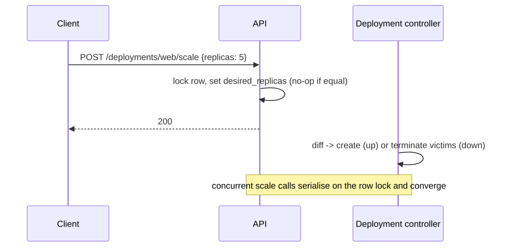

# Architecture diagrams (Mermaid)

## 1. Overall architecture

## 2. Deployment flow

## 3. Scheduling flow

## 4. Reconciliation loop

## 5. Worker registration

## 6. Heartbeat / failure detection

## 7. Container failure recovery

## 8. Worker failure recovery

## 9. Service discovery

## 10. Scaling

